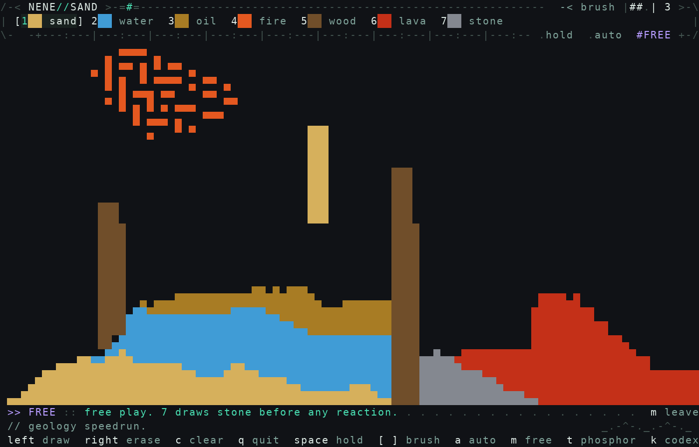
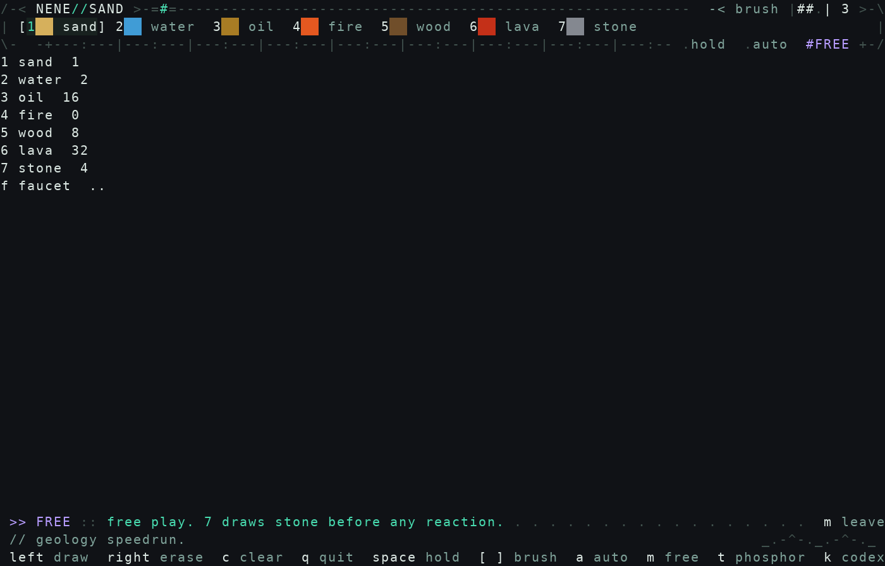

# NeNe Sand

端末で、マウスを使って砂を描いて落とすシミュレーター。コマンド名は `nene-sand`。

[English](README.md) · **日本語**



砂は落ちて積もる。水は低い方へ流れ、油はその上に浮く。火は昇って消え、木はその場に残る。溶岩はゆっくり流れ、水に触れると石になる。

上の画面は `m` の自由に遊ぶ。進行で遊ぶと、底の中央が回収口になり、消えた粒がお金になる。

## インストール

Ubuntu 22.04 以降の x86_64。Swift は要らない。

```bash
curl -fsSL https://raw.githubusercontent.com/hideyukiMORI/nene-sand/main/install.sh | bash
```

最新の [Release](https://github.com/hideyukiMORI/nene-sand/releases/latest) を取り、`SHA256SUMS` が合ってから `~/.local/bin/nene-sand` に置く。合わなければ何も置かない。スクリプトは [install.sh](install.sh)。実行する前に読める。

`~/.local/bin` が PATH に無いときは、その旨を出して終わる。多くの Ubuntu では、次のログインから入る。消すときは `rm ~/.local/bin/nene-sand`。

実行ファイルは Swift の標準ライブラリを中に持っている。外につながっているのは libc と libstdc++ と libgcc と libm だけである。

<details>
<summary>自分で置く</summary>

```bash
v=0.1.0
curl -fsSL -O https://github.com/hideyukiMORI/nene-sand/releases/download/v$v/nene-sand-linux-x86_64 \
           -O https://github.com/hideyukiMORI/nene-sand/releases/download/v$v/SHA256SUMS
sha256sum --check SHA256SUMS
install -Dm755 nene-sand-linux-x86_64 ~/.local/bin/nene-sand
```

</details>

## 操作

マウスの左で描き、右で消す。筆は `[` `]` で 1、3、5 マスになる。

| キー | すること |
| --- | --- |
| `1` `2` | 砂、水。最初から描ける |
| `3` `5` `6` | 油を 40、木を 20、溶岩を 80 で買う。足りなければ何も起きない |
| `4` | 火。溶岩が油か木に火をつけたあとで描ける |
| `7` | 石。水と溶岩で石ができてから描ける |
| `f` | 蛇口を 60 で一度だけ買う。上の中央が空なら、水が 1 粒落ちる |
| `a` | 自動描画。進行では、線の終わりに払える次の粒を一つ買い、蛇口も買う |
| `Space` | 粒の流れと自動描画を止める。描くことと消すことはできる |
| `c` | 盤の粒を全部消す。お金と、買ったものと、印は残る |
| `m` | 自由に遊ぶ。全部描ける。お金は増えない。蛇口も落ちない |
| `k` | 図鑑。売値が出る。開いているあいだ粒は止まる |
| `t` | 12 のテーマを一周する。水はどのテーマでも青 |
| `p` | 所持が 100 以上のとき、二度押すと盤とお金と蛇口を手放し、売値の倍率が 1 増える |
| `q` | 終了する。購入と所持と倍率と蛇口と、火と石の印を保存する。盤の粒は残らない |

`Ctrl+C` でも、`q` と同じく保存して端末を戻す。

## ルール

- 売値は砂 1、水 2、石 4、木 8、油 16、火 0、溶岩 32。プレステージの倍率を掛ける
- 火は買えない。溶岩が油か木に着火したときだけ解放される
- 石は、水の上下左右に溶岩が触れるとできる。斜めでは固まらない
- 火は油と木に燃え移り、水で消える。溶岩も油と木に火をつける
- 蛇口を持っていると、他の粒でふさいでも、そのマスが空いたらまた水が落ちる
- 図鑑の未解放は `..`。蛇口を持っていると `on`
- 保存先は `$XDG_DATA_HOME/nene-sand/save`、無ければ `~/.local/share/nene-sand/save`
- 窓を閉じただけでは、最後に `q` か `Ctrl+C` したところから先は残らない



## 開発

完了の定義は次の 1 コマンドである。

```bash
make check
```

Swift の版は `.swift-version` だけに書く。ソースから同じ実行ファイルを作るときは、別のディレクトリで次を使う。

```bash
swift build -c release --static-swift-stdlib
```

開発の入口は [CLAUDE.md](CLAUDE.md) と [AGENTS.md](AGENTS.md)。公開の手順は [docs/DEVELOPMENT_WORKFLOW.md](docs/DEVELOPMENT_WORKFLOW.md) のリリース節。
